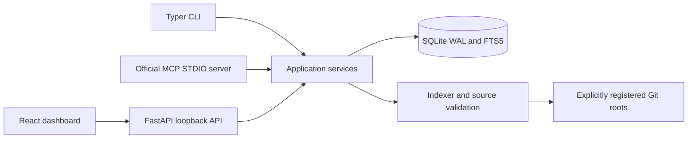

# Architecture

Memglide uses local files and a transactional SQLite database. CLI, FastAPI, and MCP transports call the same application service layer. The React dashboard calls the same HTTP API; it does not manufacture retrieval results or activity metrics.

## Two memory layers

The **persistent repository index** stores file metadata and SHA-256 hashes; symbols, signatures and locations; imports and conservative dependency relationships; and FTS5 search content. FTS5 stores searchable source once rather than duplicating a full source copy in the files table. Deleting a registration cascades through its index and associated task data, never through the source checkout.

The **temporary session layer** stores explicitly submitted observations, decisions, errors, failed attempts, fixes, open issues, and checkpoints with provenance and timestamps. Code-related memories include source hashes. Sessions survive a transport restart until their inactivity deadline or absolute lifetime expires. Cleanup deletes the session's associated memories, retrievals, passports, and events. Persistent project/index records remain.

SQLite uses foreign keys, WAL mode, a busy timeout, short transactions, and a schema migration table. CLI, MCP, and dashboard processes can share the database. A local filesystem is required; network filesystem locking semantics are outside the tested deployment model.

## Indexing and retrieval

Registration resolves an existing local Git root. Source reads validate containment and reject symlinks, secret paths, oversized/binary files, and detected sensitive content. Indexing respects default exclusions, `.gitignore`, and `.memglideignore`. It parses source without importing it or executing commands declared by it. Only Git metadata commands are run against a registered checkout.

Scans cap eligible source at 20,000 files and 100 MiB per project and report an explicitly partial index when the cap is reached. The configurable per-file size limit defaults to 512,000 bytes. Ignore rules are the supported way to focus a large repository before indexing.

Python AST and Tree-sitter extract structure. Static resolution is deliberately conservative: dynamic imports, reflection, aliases, external packages, and ambiguous calls can remain unresolved. A resolved edge means the static resolver found a source relationship; it does not prove runtime behavior.

Changed JS/TS/TSX files are parsed in bounded batches by an isolated trusted Python worker using the pinned native grammar dependencies. The worker receives source as data, never imports indexed modules, and has a 30-second batch timeout. A native fault, timeout, or parse failure becomes explicit missing structural evidence with filename/text search still available. Successful batch results are retained. The API, CLI, and MCP process can continue and report the partial index.

The selection engine combines exact identifiers, normalized search terms, paths, FTS5 evidence, dependency traversal, and current session findings. It prioritizes deterministic candidates, deduplicates evidence, checks source versions, and budgets serialized output using UTF-8 byte estimates. There are no embeddings or generated LLM summaries.

Search hits contain bounded excerpts rather than duplicate full-source payloads. Their excerpt ranges and truncation flags are distinct from the symbol's full range. An explicit `get_symbol` lookup can return the complete current source within the configured file-size limit; progressive context remains governed by its application-JSON budget.

1. **Discovery:** locations, symbols, signatures, relationships.
2. **Focused evidence:** selected implementations and direct dependencies.
3. **Expanded evidence:** broader source, callers/dependencies, and related tests where found.

A Context Passport records selected source hashes, files/symbols, resolved and unresolved dependencies, discovered tests, freshness, budget, incomplete evidence, and recommended next inspections. It reports the evidence returned; it never certifies that all context needed for a change has been found. When a file changes, previous evidence must be treated as stale. Reindex and retrieve again before relying on it.

## Runtime configuration

The database defaults to `~/.memglide/memglide.db`; `MEMGLIDE_HOME` selects another state directory, and the root CLI `--db` option selects a database file. Transports must use the same path to share projects and sessions. Keep runtime state outside indexed source or in an excluded directory.

Settings persist in SQLite. Their defaults are a 60-minute inactivity TTL, eight-hour maximum session lifetime, 4,000 estimated context tokens, 512,000-byte maximum indexed file size, file watching enabled, local event logging enabled, and a dark theme. Changing inactivity TTL affects new sessions and the next meaningful activity refresh for an existing session. The absolute lifetime deadline is fixed when each session starts. Setting values are validated by the backend.

The HTTP application serves the bundled Vite production assets, typed JSON API, and generated OpenAPI documentation from one loopback origin. Browser-origin and state-changing-request checks protect the local API. The MCP server runs over STDIO with diagnostics on stderr and no protocol logging on stdout.

Advanced deterministic scoring weights are stored under `retrieval_weights`. Update them through `PUT /api/settings`; supported keys are `exact_symbol`, `identifier`, `symbol_path`, `signature`, `file_path`, `path_terms`, `full_text`, and `task_overlap`. Partial updates merge with existing weights. Each value must be a finite number between 0 and 10,000. Changing weights affects subsequent searches; it does not rewrite historical retrievals. Exact-match prioritization remains part of the context-selection policy. Keep defaults until a measured use case justifies tuning.
