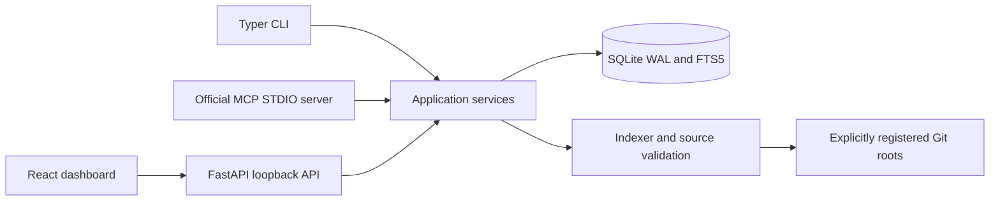

# Architecture

Memglide uses local files and a transactional SQLite database. CLI, FastAPI, and MCP transports call the same application service layer. The React dashboard calls the same HTTP API; it does not manufacture retrieval results or activity metrics.

## Two memory layers

The **persistent repository index** stores file metadata and SHA-256 hashes; symbols, signatures and locations; imports and conservative dependency relationships; and FTS5 search content. FTS5 stores searchable source once rather than duplicating a full source copy in the files table. Deleting a registration cascades through its index and associated task data, never through the source checkout.

The **temporary session layer** stores explicitly submitted observations, decisions, errors, failed attempts, fixes, open issues, and checkpoints with provenance and timestamps. Code-related memories include source hashes. Sessions survive a transport restart until their inactivity deadline or absolute lifetime expires. Cleanup deletes the session's associated memories, retrievals, passports, and events. Persistent project/index records remain.

SQLite uses foreign keys, WAL mode, a busy timeout, short transactions, and a schema migration table. CLI, MCP, and dashboard processes can share the database. A local filesystem is required; network filesystem locking semantics are outside the tested deployment model.

Memory mutations, session ending, and activity refreshes recheck the active session under the same SQLite write lock as their changes. A memory change, its event, and any activity refresh commit or roll back together. Source capture happens before taking that lock; if the session ends or expires during capture, the claim is rejected. A content-only edit preserves the provenance current when it commits. Expiration deletion checks the current deadline so an older status snapshot cannot erase a concurrently renewed session.

Status and event-history inspection do not extend inactivity. Ended sessions reject further memory work and context retrieval, while their events remain available through the read-only events API until expiry or clearing. Session/project filters still enforce ownership. Ending a session or deleting a memory does not extend its lifetime; expiration and clearing cascade through its temporary records.

## Indexing and retrieval

Registration resolves an existing local Git root. Source reads validate containment and reject symlinks, secret paths, oversized/binary files, and detected sensitive content. Indexing respects default exclusions, `.gitignore`, and `.memglideignore`. It parses source without importing it or executing commands declared by it. Only Git metadata commands are run against a registered checkout.

Scans cap eligible source at 20,000 files and 100 MiB per project and report an explicitly partial index when the cap is reached. The configurable per-file size limit defaults to 512,000 bytes. Ignore rules are the supported way to focus a large repository before indexing.

Python AST and Tree-sitter extract structure. Static resolution is deliberately conservative: dynamic imports, reflection, aliases, external packages, and ambiguous calls can remain unresolved. A resolved edge means the static resolver found a source relationship; it does not prove runtime behavior.

Changed JS/TS/TSX files are parsed in bounded batches by an isolated trusted Python worker using the pinned native grammar dependencies. The worker receives source as data, never imports indexed modules, and has a 30-second batch timeout. A native fault, timeout, or parse failure becomes explicit missing structural evidence with filename/text search still available. Successful batch results are retained. The API, CLI, and MCP process can continue and report the partial index.

The selection engine combines exact identifiers, normalized search terms, paths, FTS5 evidence, dependency traversal, and current session findings. Search and context ranking share acronym/camel/snake splitting and regular plural normalization. Corpus document frequency weights specific terms; SQLite BM25 evidence retains its score discrimination instead of assigning the same large bonus to every match. Strong symbol boosts require an exact lookup or an explicit code reference, rather than a generic prose noun. Existing FTS identifier rows are refreshed once when their normalization version changes, without reparsing unchanged sources or rewriting their hashes/timestamps.

Lexical ranking separates generic workflow sentences, such as instructions to run tests or summarize changes, from the requested behavior. Behavioral acceptance clauses and explicit source references remain eligible; exact identifier/path detection uses the original query, and fenced code is left intact. A query entirely about a test/build workflow keeps its original text. An explicit request to work on tests or documentation favors that source role; implementation tasks prefer implementation evidence. Explicit symbol/path anchors remain eligible regardless of that preference. These are deterministic lexical rules, not semantic understanding.

For long queries, all normalized terms participate in identifier/path scoring.
Full-text candidate generation uses at most 32 terms chosen by project document
frequency, which favors specific terms wherever they occur in the query. This
bounds BM25 work on large indexes; it is a candidate shortlist, not a guarantee
that every matching file will be returned. Query exact symbols/paths or expand
the retrieval when evidence is insufficient.

Selection fits direct source evidence before optional graph metadata. A separate graph allowance counts every serialized copy, including legacy passport arrays, and is also bounded against the size of the source response. Long relationship expressions become explicitly marked previews with stable identities; omissions and available full-reference inspection are disclosed. This preserves the existing dependency object API while preventing graph fan-out from displacing source. The estimator includes the complete serialized response. There are no embeddings or generated LLM summaries.

Search hits contain bounded excerpts rather than duplicate full-source payloads. Their excerpt ranges and truncation flags are distinct from the symbol's full range. An explicit `get_symbol` lookup can return the complete current source within the configured file-size limit; progressive context remains governed by its application-JSON budget.

1. **Discovery:** locations, symbols, signatures, relationships.
2. **Focused evidence:** selected implementations and direct dependencies.
3. **Expanded evidence:** broader source, callers/dependencies, and related tests where found.

Level 2 retrieval with a recognized implementation, test, or documentation intent keeps up to four primary candidate files; unclassified inspection queries bypass this cap. It retains all search candidates within each kept file. Explicit symbol/path anchors can exceed that limit, and resolved dependency expansion remains eligible under its existing limits and the response budget. Level 1, level 3, session-change queries, and explicit broad requests bypass this primary-file cap. Broad requests include callers/dependencies, “all matching files,” and “across the repository.” If focusing omits candidate files, the response sets `truncated`, reports the omission count, and marks the passport Partial. Query an exact symbol/path or expand to level 3 when those omitted matches may matter. Neither the cap nor its bypass guarantees complete retrieval.

A Context Passport records selected source hashes, files/symbols, resolved and unresolved dependencies, discovered tests, freshness, budget, incomplete evidence, and recommended next inspections. It also snapshots exact memory versions derived from content, category, provenance and stored source hashes. Changing a selected claim invalidates its previous passport even when the source file and clock have not changed. Version acknowledgements are explicit client input; another client reading a newer version cannot make an older client's acknowledgement current. It reports the evidence returned; it never certifies that all context needed for a change has been found. When evidence changes, retrieve again before relying on it.

## Runtime configuration

The database defaults to `~/.memglide/memglide.db`; `MEMGLIDE_HOME` selects another state directory, and the root CLI `--db` option selects a database file. Transports must use the same path to share projects and sessions. Keep runtime state outside indexed source or in an excluded directory.

Settings persist in SQLite. Their defaults are a 60-minute inactivity TTL, eight-hour maximum session lifetime, 4,000 estimated context tokens, 512,000-byte maximum indexed file size, file watching enabled, local event logging enabled, and a dark theme. Changing inactivity TTL affects new sessions and the next meaningful activity refresh for an existing session. The absolute lifetime deadline is fixed when each session starts. Setting values are validated by the backend.

The settings API requires JSON integers for integer settings, JSON booleans for switches, and finite JSON numbers for retrieval weights. It rejects numeric strings, booleans used as numbers, and strings used as switches instead of coercing them. Partial retrieval-weight updates continue to merge with stored weights.

Context retrieval and passport revalidation use one defensive settings snapshot per request, shared by nested work and isolated from concurrent requests. Callers receive copies, so mutating a returned settings object cannot alter the snapshot. The snapshot is discarded on normal return or error; the next request reads persisted settings again. Source hashes and file safety checks remain live validations, independent of this settings snapshot.

The HTTP application serves the bundled Vite production assets, typed JSON API, and generated OpenAPI documentation from one loopback origin. Browser-origin and state-changing-request checks protect the local API. The MCP server runs over STDIO with diagnostics on stderr and no protocol logging on stdout.

Advanced deterministic scoring weights are stored under `retrieval_weights`. Update them through `PUT /api/settings`; supported keys are `exact_symbol`, `identifier`, `symbol_path`, `signature`, `file_path`, `path_terms`, `full_text`, and `task_overlap`. Partial updates merge with existing weights. Each value must be a finite number between 0 and 10,000. Changing weights affects subsequent searches; it does not rewrite historical retrievals. Exact-match prioritization remains part of the context-selection policy. Keep defaults until a measured use case justifies tuning.
