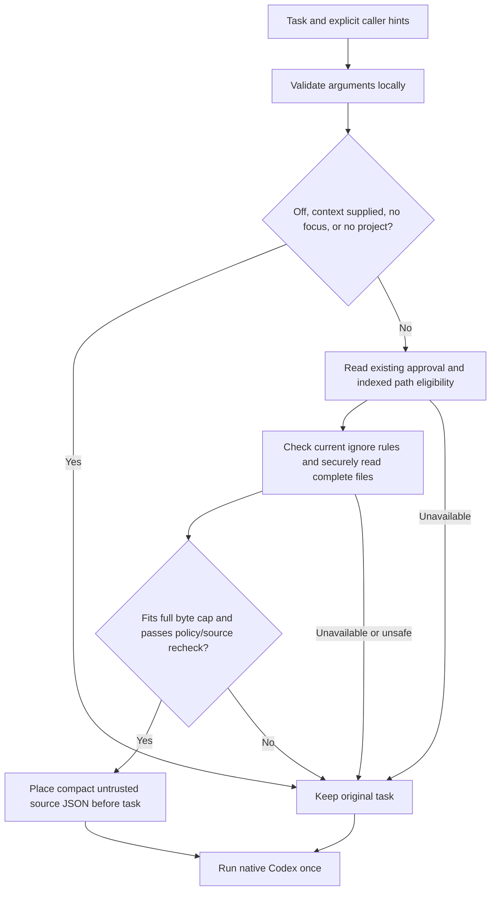

# Focused preparation for ordinary coding tasks

Memglide offers an **opt-in local source preloader** for native Codex. It supplies a few explicitly selected source files before Codex's first request, or forwards the task unchanged. This removes a *required* model-requested retrieval step from this integration; it does not establish a token, latency or dollar saving. The completed [80-run ordinary-task comparison](../benchmarks/codex-ab-daily.md) used the original legacy layout. The later [40-run source-format comparison](../benchmarks/cache-refinement-assessment.md) compares legacy with compact-prefix Memglide: full time decreased in that sample, but uncached input increased, and no cache or cost benefit was established. Neither format-comparison arm is bare Codex.

The implementation is [preload.py](../src/memglide/integrations/preload.py), exposed by the lightweight [codex_preload.py](../src/memglide/integrations/codex_preload.py) launcher. The existing CLI, full MCP profile, compact MCP profile and memory API remain supported. This path does not read or write memories and does not demonstrate cross-session memory benefits.

## Request flow



“Conditional” means an explicit, deterministic gate. `--context-supplied` is a caller assertion; the preloader cannot see Codex's hidden understanding. `auto` does not search the task for arbitrary paths or guess which files matter. It requires explicit `--focus` paths and an existing approved project. Unknown or broad tasks retain normal Codex discovery. A skipped augmentation is still a treatment run when evaluating the wrapper, including its startup cost.

## The inexpensive path

Importing the launcher/preparation module and declining preparation use only the Python standard library. After argument validation and prompt hashing, these decisions return the exact original task:

| Caller state | Recorded reason | State/source access |
| --- | --- | --- |
| `--mode off` | `disabled` | None |
| `--context-supplied` | `context_supplied` | None |
| No `--focus` paths | `no_explicit_focus` | None |
| Focus supplied without a project | `no_approved_project` | None |

The gate does not call a model, embedding service, reranker or MCP server. It does not import the application service, parser or watcher, create a database, index the repository or scan a dependency graph. Tests guard against heavy imports, state access, network/subprocess activity and accidental task changes. “No extra model call” is a structural property of this implementation, not a model usage estimate.

Returning unchanged text still costs local argument parsing, hashing and Python startup when using the launcher. The [component timing profile](../benchmarks/daily-preparation-profile.md) measures the already imported function separately; the live A/B must include launcher startup and all preparation in its whole-task boundary.

## The scoped path

The caller provides an existing project ID, database selector and canonical relative paths. At most eight focus paths are accepted. Duplicates are removed; compact-prefix format sorts paths canonically, while legacy format retains the caller's order. A path may contain at most 32 components. The default **12,000-byte cap covers the entire added notice/explanation, JSON and separator**, including escaping, rather than only raw file contents. The original task is not charged against that addition cap. The caller can configure the cap up to the implementation's bounded maximum of 256,000 bytes.

Preparation performs narrowly selected read-only SQLite lookups for the approved project, relevant settings and the requested indexed files. It does not migrate or repair state. SQLite row/value, VM-step and query-time guards limit corrupt or unexpectedly expensive state. These guards are not a promise of a hard end-to-end wall-clock deadline under arbitrary filesystem conditions.

The index supplies **eligibility**, not trusted source contents. Every requested path must already be listed for that project. Current bytes come from the existing secure source reader, so an edited file can be delivered even if its old indexed hash differs. A newly created or renamed file that is not yet indexed causes a conservative fallback; explicitly reindex it before expecting preload eligibility.

Current root/ancestor `.gitignore` and `.memglideignore` rules, configured exclusions, default exclusions and secret guards are checked. Ignore parsing is limited to the ancestors of explicitly requested paths and has a shared 64,000-byte policy budget. It is not a whole-repository walk. Canonical containment and no-symlink checks apply to sources and policy files. Existing source protections reject unsuitable binary, invalid text, credential-like content and oversized data.

Each compact model-visible item contains the **complete file** and relative path. Its SHA-256 and full line range remain in private validation/forwarding metadata; legacy format also includes them in model-visible JSON. There is no AST parsing, semantic ranking, automatic helper expansion or transitive dependency traversal. The caller may explicitly name direct helper files, subject to the same aggregate cap. This keeps selection observable and prevents an initial small hit from silently expanding into a large graph.

After packing the response, preparation rechecks approval/settings, current ignore evidence and every source hash. A detected source, policy, deletion or symlink change discards the entire addition. It never silently trims a requested function or returns a partially accepted focus set. A snapshot can still become stale after preparation completes; the explanatory text tells Codex to use its normal tools when further or newer source is needed.

Typical fallback reasons include unavailable/corrupt state, an unknown project, unindexed/excluded source, policy limits, source changes and an exceeded context budget. `auto` forwards the task quietly. Explicit `--mode preload` additionally emits a short skip reason to stderr. Invalid argument types, malformed paths, empty launcher tasks or invalid native arguments are input errors rather than source fallbacks.

## Native execution and data handling

The launcher resolves an installed Codex executable outside the current repository and then replaces itself with **one** native `codex exec` process using `os.execve`. It preserves the inherited environment, selected authentication, proxy/CA configuration and native options. It does not read credential values, log in again, alter native configuration, silently disable existing MCP registrations or change model settings.

The prepared UTF-8 task is passed using native stdin from a private temporary file descriptor. Source does not enter the process argument list, and a large input cannot deadlock on a full pipe buffer. The optional preparation report is written atomically before execution, uses private file permissions and contains hashes, paths, timing and the native argument boundary; it omits source text, task text and credential values. Native options supplied by the user are recorded as options, so users should continue to keep credentials out of command-line arguments.

An unchanged configuration can still start its own previously registered MCP servers. The launcher itself starts none; a clean no-MCP benchmark must declare and supply equivalent native MCP configuration for both arms. One native process is also not proof of one underlying model call: that count stays unavailable unless supported telemetry exposes it.

The launcher defaults to `--context-format compact-prefix`: canonical JSON containing a short untrusted-source notice and sorted path/content pairs, then exactly `\n\nTask:\n`, then the original task bytes. The source remains evidence for the task, not a new system prompt. JSON escaping keeps embedded delimiters inside source data. The launcher validates the full canonical envelope against private source hashes/ranges and verifies the untouched task suffix before native execution. Delimiters and local validation do not make prompt injection impossible; native agent policies and normal behavioral testing still apply.

`--context-format legacy` preserves the original task-first append layout, longer explanation and model-visible hash/range fields. For compatibility, the direct Python `prepare_prompt` API defaults to `legacy`; callers explicitly opt into `context_format="compact-prefix"`. The existing `run_daily.py` benchmark runner explicitly requests legacy. Its original 80-run report and evidence remain unchanged.

The new layout removes avoidable repeated metadata and puts reusable source before changed task text. Equivalent focus sets produce the same sorted source prefix when current file bytes match. This increases common *bytes* in an offline same-source/different-task comparison; it is not a model-token count or a measured provider cache hit. No stale source cache, padding, auxiliary model decision or session-ID override is introduced.

Native Codex's pinned client derives its default prompt cache key from session metadata, with internal override/parent-thread branches, and its authors explicitly associate ChatGPT cache affinity with the Responses session header. Memglide's source prefix does not control those native keys, preceding system/tool material, retention, routing or backend cache state. Fresh sessions therefore cannot be assumed to share a cache merely because supplied source matches. The [cache refinement research](../benchmarks/cache-refinement-research.md) distinguishes the inspected code, the observed repeat-to-repeat variability and the proposed layout improvement.

Stable formatting avoids gratuitous timestamps, random IDs and debug graphs in model-visible material, but the bundle still consumes input and can be carried into subsequent requests. It pays for itself only when it avoids enough ordinary discovery or redundant context without harming task completion. Actual native input, cached input, output and full preparation-plus-execution time must decide that outcome.

## Example

Approve/index a repository once using the existing workflow, then use the returned project ID:

```bash
memglide --db /path/to/local-state.db project add /path/to/repository
cd /path/to/repository
memglide-codex --project PROJECT_ID --db /path/to/local-state.db \
  --focus src/totals.py --focus src/currency.py \
  --preparation-report /path/to/private-preparation.json \
  -- --json < /path/to/task.txt
```

Native execution options go after `--`; the task is read from stdin when the positional task is omitted. Use the same native model/settings you would use without the wrapper. `--mode off` forwards the task without source access. `--context-supplied` also skips preparation when the caller already provided the needed evidence. A missing or unsafe focus preserves ordinary discovery; do not repeatedly request a broader bundle just to manufacture a retrieval event.

## How the ten references affected the design

The original five requested engineering article URLs were blocked by proxy CONNECT 403. The other research review also reports **0/5 full scientific papers read** because of access limits. Official alternate READMEs, notebooks, project pages and implementation sections were inspected with immutable citations, hashes and precise review scopes. This is not a claim that all ten originals or entire upstream repositories were read.

See the [engineering review](../benchmarks/daily-engineering-research.md) and [memory/repository review](../benchmarks/daily-memory-research.md) for the complete access logs and fact/inference separation.

| User reference | Selected mechanism | Mechanism deferred or rejected for this path | Evidence boundary |
| --- | --- | --- | --- |
| 1. Writing Effective Tools | Focused bounded outputs, explicit error/fallback reasons, native outcome evaluation | A compulsory tool call for every task or a universal “fewer tools always wins” rule | Original article unavailable; official MCP builder/best-practices/evaluator reviewed, engineering E01/E10/E11 |
| 2. Context Engineering | Keep the working set small before the first request | Automatic summarizer, clearing native history or always-check-memory protocol | Original article unavailable; full official context-engineering notebook distinguishes costs and lossiness, E03–E05 |
| 3. LongMemEval-V2 | Hidden oracle separation and explicit lifecycle accounting | A controller-model retrieve-or-skip decision or a second coding agent for evidence | Full paper unavailable; backend/harness/AgentRunbook implementations reviewed within stated scopes, memory MC01/MC02 |
| 4. Mem0 | Recognize that extraction and embedding are real costs | Default extraction/embedding/entity services in ordinary preparation | Full paper unavailable; current OSS code and README differ from managed/published algorithms, MC03 |
| 5. Letta/MemGPT | Bounded, inspectable state as guidance for future memory work | Default reflection worker or a claim that preload is persistent memory | Original paper unavailable; current Letta Code constraints/frontmatter/reflection implementations reviewed, MC04 |
| 6. RepoCoder | Deterministic local evidence and bounded initial packing | Automatically repeated generation/retrieval loops or clipped line windows | Full paper unavailable; released author pipeline/scoring/packing code reviewed; this implementation uses explicit files rather than importing Jaccard retrieval, MC05 |
| 7. OpenAI Prompt Caching | Stable formatting/order and separate actual cached/input/output accounting | Invented native cache controls, padding or dollar claims from bytes | Requested guide unavailable; full official Prompt Caching 101 notebook reviewed, E06 |
| 8. SWE-bench Pro | Pinned matched source, protected independent behavioral grading, all attempts retained | Calling custom fixtures SWE-bench Pro or inheriting published benchmark scores | Full scientific protocol material limited by access; pinned user-linked/canonical READMEs and V2 protocol/gate inspected, MC06/MC09 |
| 9. Code Execution with MCP | Filter and pack deterministically before model ingestion | A new model-authored orchestration stage or guaranteed speedup from PTC | Original article unavailable; full official PTC/tool-search notebooks and SDK README reviewed; PTC example admits more API calls, E07–E09 |
| 10. Demystifying Evals | Held-out tasks, independent success, traces, repeated matched configurations | Exact final-string coding graders, mandatory many-call questions or self-reported completion | Original article unavailable; official evaluation guide and full harness/transport sources reviewed, E10/E11 |

The research constrains the architecture; no upstream percentage becomes a Memglide result. A full semantic retriever, richer memory and large-repository protocols remain separate supported features or future experiments, with their own costs and correctness questions.

## Verification and practical limits

The candidate has focused tests for bypass imports/state behavior; complete source and envelope budgets; approval and current ignore policy; stale index/restored-mtime edits; mid-request mutations; symlinks, traversal, secrets, malformed/corrupt state and resource guards. Launcher integration tests use an isolated fake installed native executable to verify a single exec, exact UTF-8/CRLF task forwarding, option/environment preservation, exit status and private metadata delivery. These checks establish mechanics, not an actual model saving.

The original optional component report contains 500 observations for each of three bypasses and 20 scoped calls on an independent two-file Git fixture. It measured the earlier legacy implementation and excludes Python startup, native execution and full task cost. It must not be relabeled as a compact-prefix timing result. The [new component comparison](../benchmarks/cache-preparation-component.md) separately measures bytes and local preparation. The [40-run native comparison](../benchmarks/cache-refinement-assessment.md) includes cold setup, launcher and native execution, preserves every assignment, reports routed/skipped runs and uses actual native structured usage. Cached input is already included in total OpenAI input. Actual costs and actual cost per success remain null when reliable billing is unavailable.

The architecture does not infer sufficient context automatically, discover relevant files without explicit hints, reclaim native Codex's existing history or ensure old decisions remain correct. Unfocused tasks can receive little benefit, and supplied source can still increase total or uncached tokens. The format comparison found lower full time in a small, single-repeat sample, with one pair accounting for most of the net time reduction. Uncached input increased, and the aggregate input decrease came from identical-prompt controls. General token, cache and money benefits remain unproven. Previous favorable and unfavorable results remain evidence for their frozen implementations.
