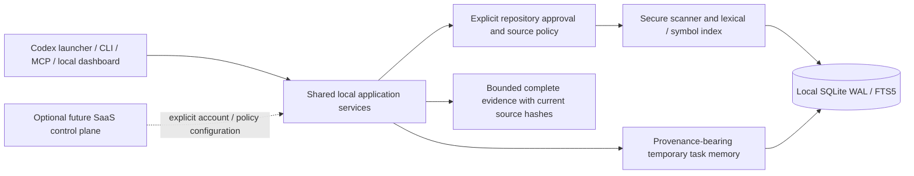

# Product architecture for efficient local context

Memglide should keep its source and memory engine on the developer's machine, with an optional SaaS control plane for account and organization features. The implemented changes remove repeated local work while preserving complete live source validation. They do not establish hosted production readiness, a universally best architecture, or lower model bills.

The [combined assessment](https://github.com/iamsreecharan/Memglide/blob/8acc8af/benchmarks/saas-efficiency-assessment.md) separates the new component measurements from the older native Codex studies. The [research review](https://github.com/iamsreecharan/Memglide/blob/8acc8af/benchmarks/saas-efficiency-research.md) records six newly verified primary sources and their exact reading scopes; it does not claim to have read every paper or book.

## Keep the request path local

The local data plane owns repository approval, ignore policy, secure source reads, indexing, retrieval, freshness and task-memory lifecycle. All transports continue sharing those services. Source bodies, local paths and memory contents stay local unless the user explicitly chooses a separate export or integration. Repository files and stored text remain untrusted data.

An optional future control plane can manage accounts, organizations, entitlements, release channels and explicit policy configuration. It should not require an online round trip for each local retrieval. Remote authentication, tenant isolation, TLS, billing, disaster recovery and operational service targets require separate implementation and testing; these changes do not provide them. The existing HTTP server remains a loopback service.

## Implemented changes and why they are safe

### Reuse graph results only when their inputs are unchanged

Every normal refresh still securely reads and hashes every eligible file. The indexer resolves graph targets when eligible files are added, changed or removed, for explicit full rebuilds, and when the persisted graph-resolution version differs from the current version. An unchanged source set with the same resolver version retains its existing graph targets. A separate graph version lets an older database refresh once without repeating that work on every poll or search.

This reuses derived graph results after live input validation. It does not treat old hashes, mtimes or watcher notifications as proof that current source is unchanged. The measured unchanged 600-file fixture retained identical graph outputs and source hashes, with 600 secure reads in both arms, while removing 1,198 graph-row updates per refresh.

### Release unchanged file bodies after validating them

The scanner can accept known hashes from the existing index. It performs the same complete secure read, secret/ignore-policy checks, content hash and byte-limit accounting. Once a live hash matches, it releases the body rather than retaining another full in-memory copy for the rest of the scan. Changed and newly eligible files retain complete bodies for parsing and indexing. Explicit full rebuilds retain all bodies; callers using the default scanner interface continue receiving complete source.

On the 20 MiB unchanged fixture, this reduced measured peak Python allocations from about 21.53 MB to 1.60 MB. `tracemalloc` does not measure total process RSS, server memory or all native allocations. Forty secure reads still occurred in each arm. The same resource limits, symlink rejection, credential checks and nested ignore semantics remain authoritative.

### Make bookkeeping proportional to scheduling needs

The watcher now reads only project IDs, paths and the watch-enabled setting for scheduling. It avoids repeatedly decoding full project reports. Default control-state refresh is at most once per second, while the worker still wakes for debouncing. Moves check both source and destination so a file crossing an ignored boundary can request reconciliation.

Full background reconciliation remains configured at five seconds, alongside debounced events and polling fallback. A completed event scan also satisfies that project's periodic audit. The periodic timer advances after a scan finishes, preventing an expensive scan from causing an immediate continuous polling loop. A five-second interval is not a maximum freshness-lag guarantee: scans, contention and scheduling take time. Foreground retrieval/search refreshes still perform their existing live full scans.

Shutdown retains a worker that outlasts the bounded join. Restart cannot clear that worker's stop event and create a second live worker. It can start fresh once the old worker actually exits. This prevents duplicate workers without pretending a slow scan can always be interrupted immediately.

The dashboard reuses its session list, performs fewer expiration-cleanup calls and asks SQL for the 20 events it displays. The general event-history operation retains its 500-item default and validates an optional internal limit. These changes preserve the compared dashboard response rather than creating a second cached status model.

### Index ordinary SQLite access paths

Nine additive indexes cover missing foreign-key child lookups, project/session history and recent-event/retrieval ordering. Existing primary-key and prefix indexes are reused. Index creation uses `IF NOT EXISTS`; stored memories, source bodies and record ownership are preserved. Tests exercise upgrade idempotence, actual query plans and deletion/invalidation isolation across projects and sessions.

The fixture's new indexes occupy 839,680 bytes. One measured event append requires 44 → 55 SQLite VM instructions because additional indexes must be maintained. The measured read and cascade work falls substantially, but added indexes are a storage/write tradeoff. First-time index construction also takes a database write lock. No connection pool, remote database or extra worker is introduced.

## Preserve the model-facing defaults

Source-only preparation remains the default. Complete supporting files remain explicit and optional: the earlier native comparison did not justify promoting them. Deterministic off, supplied-context, missing-focus and missing-project passthroughs remain cheap and require no classifier model. The current source-delivery formats and native Codex event-stream handling are unchanged by the four local efficiency changes.

Do not replace complete bounded evidence with bare resource links by default. An MCP/IDE evidence picker may be useful when a host supports explicit resource reads, but a link can introduce another interaction or leave necessary source unread. No new embedding service, vector database, LLM selector, reflection worker or remote graph service is added without an end-to-end successful-task comparison that includes its setup and maintenance costs.

An unchanged source hash and a native thread ID do not prove that source remains in the model's context after compaction. A stable substring inside one changing user message does not prove a provider cache boundary. No hidden cache-header changes, privileged-source injection or automatic omission based on an old receipt is justified.

## Memory is a separate feature and evaluation

The implemented repository index persists; task memory is bounded by its existing active-session deadlines. Native Codex sessions and Memglide sessions are different lifecycles. Source preload alone does not reuse decisions from an earlier native session.

The opt-in [memory preparation adapter](memory-preload.md) passes 43 regression cases and nine real lifecycle/freshness prerequisite checks. The [warm-task evaluation](https://github.com/iamsreecharan/Memglide/blob/8acc8af/benchmarks/warm-80-analysis.md) completed 80 passing assignments after fresh authorization, then stopped at the user’s request. An already-started 81st original was interrupted and retained. In the descriptive matched first 72 runs, source-only B has a 9.05% lower API-price-equivalent cost and 6.89% lower mean instrumented time than A; warm C is 12.35% costlier and 3.40% slower than B. The final audit passes with incomplete coverage. One repeat, small repositories and uncontrolled provider/OS caches do not justify default promotion or actual billed savings. Their initial scope is related native sessions sharing the **same still-active Memglide session**, not durable memory across expired or ended Memglide sessions. Any report must include preparation, memory writing, retrieval and unsuccessful attempts, verify current source, grade independently and preserve controls. A component speedup is not a substitute for this native comparison.

## Candidates that need their own evidence

FTS5 equality on stored `project_id`/`path` columns does not become a relational B-tree lookup. A transactional `(project_id, path)` to FTS-rowid mapping is a credible next candidate, with migration, backfill, duplicate/orphan detection, project removal and multi-project tests. It is not implemented in this round; direct writes to FTS shadow tables are inappropriate.

Native-only watching or longer audit intervals could reduce I/O but change missed-notification recovery. They require overflow, mount, rename, observer failure and ignore-policy tests before changing the current audit policy. Replacing the scanner with ripgrep or a tracked-file manifest also requires preserving Memglide's untracked-source, nested-ignore, secret and symlink semantics.

Persistent project events currently have no retention deadline, and session contents/list responses have no product quota beyond existing per-item limits and session lifetime. Explicit retention, visible quotas and versioned pagination are future product work; silently truncating correctness-sensitive memory APIs would be unsafe. These limitations, large unfamiliar repositories and real hosted operations remain part of readiness work.

## Promotion requires measured outcomes

The new probes establish less local SQL, JSON decoding and retained Python data on their fixtures. Their baselines differ, so percentages must not be added or pooled. Graph and scan timing runs briefly overlapped under uncontrolled host load and OS caches. The scheduler uses virtual time; database probes count SQLite instructions rather than milliseconds.

The older source-only native point estimate of 10.19% lower focused-task cost and 3.18% longer mean full time applies to its frozen implementation and corpus. It does not automatically transfer to this code. Actual billed savings remain unknown. Promote a new model-facing strategy only after fresh matched tasks preserve correctness, evidence completeness and freshness while demonstrating acceptable cost per successful task and latency, with every failed run retained.
